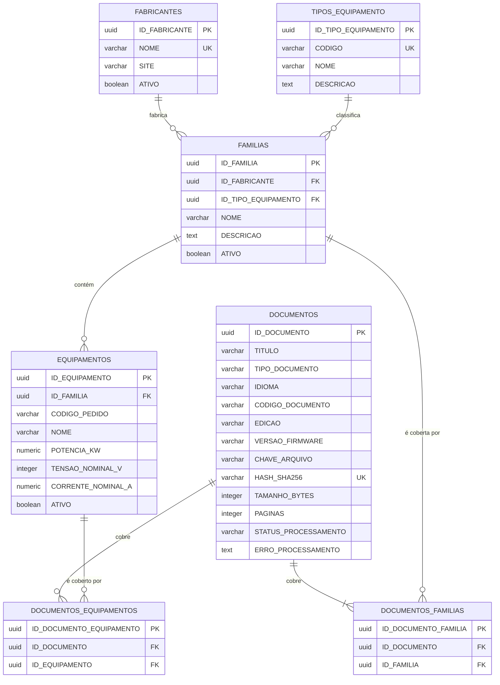

# 02 — Banco de dados

PostgreSQL 17 com a extensão [pgvector](https://github.com/pgvector/pgvector), rodando na imagem `pgvector/pgvector:pg17`. O schema é versionado pelo Alembic (ver [03 — Migrations](03-migrations.md)). Compatível com PostgreSQL 16–18: não usamos sintaxe exclusiva de versão nova.

## Diagrama



Todas as tabelas também têm `createdAt` e `updatedAt` (omitidos no diagrama).

## Como ler o modelo

```text
Fabricante → Família/Série → Modelo (Equipamento) → Documento → (fase 2) Trechos com embedding
 Siemens      SINAMICS G120   6SL3210-1KE21-3UF1     Lista de parâmetros
```

- Um **fabricante** tem várias **famílias** (linhas de produto).
- Cada família tem um **tipo de equipamento** (inversor, soft starter, relé de gerenciamento).
- Uma família tem vários **equipamentos** (modelos concretos, identificados pelo código de pedido).
- Um **documento** cobre **uma ou mais famílias** (obrigatório) e, opcionalmente, **modelos específicos**. Ex.: um manual de parâmetros liga-se à família; um datasheet liga-se à família e ao modelo.

## Convenções

| Item | Regra | Exemplo |
|---|---|---|
| Tabelas | MAIÚSCULO, plural | `FAMILIAS`, `DOCUMENTOS_FAMILIAS` |
| Colunas de negócio | MAIÚSCULO | `NOME`, `CODIGO_PEDIDO` |
| Timestamps | camelCase com aspas (herança do Sequelize) | `"createdAt"`, `"updatedAt"` |
| Chave primária | UUID `gen_random_uuid()`, nome `ID_<ENTIDADE>` | `ID_FAMILIA` |
| Chave estrangeira | UUID com o mesmo nome da PK referenciada | `FAMILIAS.ID_FABRICANTE` |
| Primary key | `PK_<TABELA>` | `PK_FAMILIAS` |
| Unique | `UK_<TABELA>_<COLUNAS>` | `UK_FAMILIAS_ID_FABRICANTE_NOME` |
| Foreign key | `FK_<TABELA>_<COLUNA>_<TABELA_REF>` | `FK_FAMILIAS_ID_FABRICANTE_FABRICANTES` |
| Índice | `IDX_<TABELA>_<COLUNAS>` | `IDX_FAMILIAS_ID_TIPO_EQUIPAMENTO` |
| Check | `CK_<TABELA>_<NOME>` | `CK_DOCUMENTOS_IDIOMA` |

- Nunca PK/FK numérica (`serial`, `integer`). `INTEGER` só para quantidades e medidas inteiras.
- Os nomes de constraint são gerados pela `NAMING_CONVENTION` em `app/core/db.py`.
- No Python os atributos são snake_case e o nome físico é explícito: `nome: Mapped[str] = mapped_column("NOME", ...)`.
- Toda coluna e tabela tem `comment` (aparece no `\d+` do psql e em ferramentas gráficas).

## Tabelas

### `TIPOS_EQUIPAMENTO`

Categorias de equipamento. Tabela (e não lista fixa no código) para permitir novos tipos sem alterar código.

| Coluna | Tipo | Nulo | Regra |
|---|---|---|---|
| `ID_TIPO_EQUIPAMENTO` | `uuid` | não | PK |
| `CODIGO` | `varchar(40)` | não | Único; identificador estável usado por integrações |
| `NOME` | `varchar(100)` | não | Nome de exibição |
| `DESCRICAO` | `text` | sim | |

Dados iniciais (migration `insere_tipos_equipamento_iniciais`):

| `CODIGO` | `NOME` |
|---|---|
| `RELE_GERENCIAMENTO` | Relé de gerenciamento de motor |
| `SOFT_STARTER` | Soft starter |
| `INVERSOR` | Inversor de frequência |

### `FABRICANTES`

| Coluna | Tipo | Nulo | Regra |
|---|---|---|---|
| `ID_FABRICANTE` | `uuid` | não | PK |
| `NOME` | `varchar(100)` | não | Único (a API também impede duplicado ignorando maiúsculas/minúsculas) |
| `SITE` | `varchar(255)` | sim | |
| `ATIVO` | `boolean` | não | Padrão `true` |

### `FAMILIAS`

Linha de produto. Ex.: SINAMICS G120, SIRIUS 3RW55, SIMOCODE pro V, CFW500.

| Coluna | Tipo | Nulo | Regra |
|---|---|---|---|
| `ID_FAMILIA` | `uuid` | não | PK |
| `ID_FABRICANTE` | `uuid` | não | FK → `FABRICANTES`, `ON DELETE RESTRICT` |
| `ID_TIPO_EQUIPAMENTO` | `uuid` | não | FK → `TIPOS_EQUIPAMENTO`, `ON DELETE RESTRICT`; indexada |
| `NOME` | `varchar(150)` | não | Único por fabricante (`UK_FAMILIAS_ID_FABRICANTE_NOME`) |
| `DESCRICAO` | `text` | sim | |
| `ATIVO` | `boolean` | não | Padrão `true` |

### `EQUIPAMENTOS`

Modelo concreto, identificado pelo código de pedido (MLFB, na Siemens).

| Coluna | Tipo | Nulo | Regra |
|---|---|---|---|
| `ID_EQUIPAMENTO` | `uuid` | não | PK |
| `ID_FAMILIA` | `uuid` | não | FK → `FAMILIAS`, `ON DELETE RESTRICT` |
| `CODIGO_PEDIDO` | `varchar(60)` | não | Único por família (`UK_EQUIPAMENTOS_ID_FAMILIA_CODIGO_PEDIDO`) |
| `NOME` | `varchar(200)` | não | Ex.: "PM240-2 5,5 kW 400 V" |
| `POTENCIA_KW` | `numeric(10,3)` | sim | Decimal exato (sem erro de ponto flutuante) |
| `TENSAO_NOMINAL_V` | `integer` | sim | |
| `CORRENTE_NOMINAL_A` | `numeric(10,3)` | sim | |
| `ATIVO` | `boolean` | não | Padrão `true` |

### `DOCUMENTOS`

Metadados do documento técnico. O PDF **não** fica no banco: fica em armazenamento de arquivos (pasta local, depois MinIO/S3) e o banco guarda a chave e o hash.

| Coluna | Tipo | Nulo | Regra |
|---|---|---|---|
| `ID_DOCUMENTO` | `uuid` | não | PK |
| `TITULO` | `varchar(300)` | não | |
| `TIPO_DOCUMENTO` | `varchar(30)` | não | `CHECK`: `MANUAL_OPERACAO`, `LISTA_PARAMETROS`, `GUIA_RAPIDO`, `MANUAL_COMUNICACAO`, `DATASHEET`, `NOTA_APLICACAO` |
| `IDIOMA` | `varchar(5)` | não | `CHECK`: `pt-BR`, `en` |
| `CODIGO_DOCUMENTO` | `varchar(60)` | sim | Número do fabricante (ex.: `A5E33840768`) |
| `EDICAO` | `varchar(30)` | sim | Ex.: `09/2023` |
| `VERSAO_FIRMWARE` | `varchar(30)` | sim | Parâmetros mudam entre firmwares |
| `CHAVE_ARQUIVO` | `varchar(500)` | sim | Preenchida no upload (fase 2) |
| `HASH_SHA256` | `varchar(64)` | sim | Único; evita o mesmo PDF duas vezes |
| `TAMANHO_BYTES` | `integer` | sim | |
| `PAGINAS` | `integer` | sim | |
| `STATUS_PROCESSAMENTO` | `varchar(20)` | não | `CHECK`: `PENDENTE` (padrão), `PROCESSANDO`, `INDEXADO`, `ERRO` |
| `ERRO_PROCESSAMENTO` | `text` | sim | Mensagem da última falha de ingestão |

### `DOCUMENTOS_FAMILIAS` e `DOCUMENTOS_EQUIPAMENTOS`

Tabelas de ligação N:N. Cada uma tem PK UUID própria, as duas FKs e um `UNIQUE` no par.

| Tabela | FK para documento | FK para o outro lado | Índice extra |
|---|---|---|---|
| `DOCUMENTOS_FAMILIAS` | `ID_DOCUMENTO` → `DOCUMENTOS`, `CASCADE` | `ID_FAMILIA` → `FAMILIAS`, `RESTRICT` | `IDX_DOCUMENTOS_FAMILIAS_ID_FAMILIA` |
| `DOCUMENTOS_EQUIPAMENTOS` | `ID_DOCUMENTO` → `DOCUMENTOS`, `CASCADE` | `ID_EQUIPAMENTO` → `EQUIPAMENTOS`, `RESTRICT` | `IDX_DOCUMENTOS_EQUIPAMENTOS_ID_EQUIPAMENTO` |

O `UNIQUE (ID_DOCUMENTO, X)` já serve de índice para buscas por documento; o índice extra cobre buscas pelo outro lado ("quais documentos cobrem esta família?").

## Regras de exclusão

| Ao excluir… | Comportamento | Motivo |
|---|---|---|
| Fabricante com famílias | Bloqueado (`RESTRICT`) → API responde 409 | Protege o histórico; use `ATIVO = false` |
| Família com equipamentos ou documentos | Bloqueado → 409 | Idem |
| Equipamento ligado a documentos | Bloqueado → 409 | Idem |
| Tipo de equipamento em uso | Bloqueado | Tipos são referência estável |
| Documento | Permitido; vínculos removidos em cascata | O documento é o "dono" dos vínculos |

## Extensões

| Extensão | Migration | Uso |
|---|---|---|
| `vector` (pgvector) | `habilita_extensao_vector` | Tipo `vector(N)` e operadores de distância (`<=>` cosseno, `<->` euclidiana, `<#>` produto interno). Será usada na tabela `TRECHOS` (fase 2) |

`gen_random_uuid()` é nativa do PostgreSQL 13+ (não precisa de extensão).

## Consultas úteis

```sql
-- Estrutura de uma tabela com comentários
\d+ "FAMILIAS"

-- Versão do schema aplicada
SELECT * FROM alembic_version;

-- Documentos de uma família, com o fabricante
SELECT d."TITULO", d."TIPO_DOCUMENTO", d."IDIOMA", f."NOME" AS familia, fb."NOME" AS fabricante
FROM "DOCUMENTOS" d
JOIN "DOCUMENTOS_FAMILIAS" df ON df."ID_DOCUMENTO" = d."ID_DOCUMENTO"
JOIN "FAMILIAS" f ON f."ID_FAMILIA" = df."ID_FAMILIA"
JOIN "FABRICANTES" fb ON fb."ID_FABRICANTE" = f."ID_FABRICANTE"
ORDER BY fb."NOME", f."NOME", d."TITULO";
```

Como os nomes são maiúsculos, no SQL puro eles **precisam de aspas duplas** (`"FAMILIAS"`). Sem aspas, o PostgreSQL converte para minúsculo e não encontra a tabela. No código Python o SQLAlchemy coloca as aspas sozinho.

## Próximas tabelas (planejadas)

| Tabela | Fase | Conteúdo |
|---|---|---|
| `TRECHOS` | 2 | Pedaços do documento: `CONTEUDO`, `SECAO`, `PAGINA`, `TIPO_CONTEUDO`, `EMBEDDING vector(N)` com índice HNSW e coluna `tsvector` para busca textual |
| `PARAMETROS` | 3 | Parâmetros estruturados por família/firmware (código, descrição, unidade, faixa, padrão) |
| `FALHAS` | 3 | Códigos de falha/alarme com causa e solução |

A dimensão `N` do vetor depende do modelo de embedding escolhido (ex.: 1024 para bge-m3, 1536 para OpenAI text-embedding-3-small) e trocá-la exige reprocessar todos os trechos.
